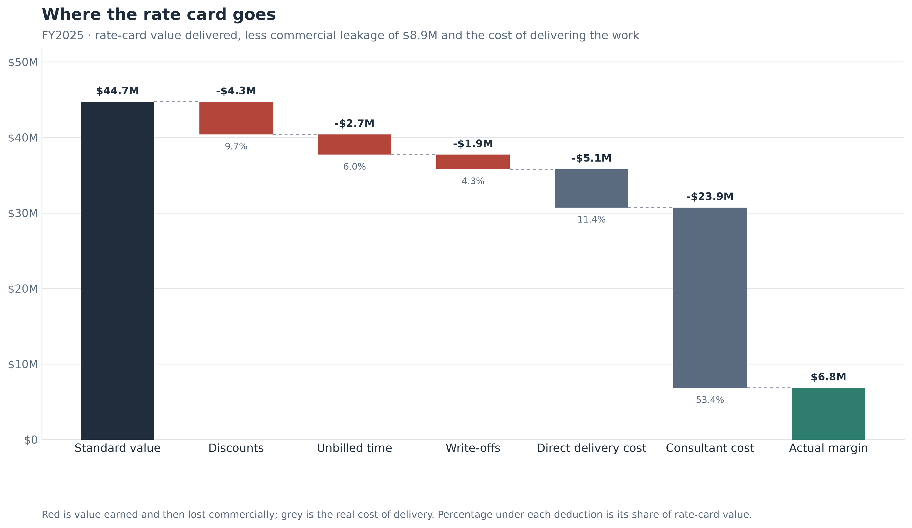
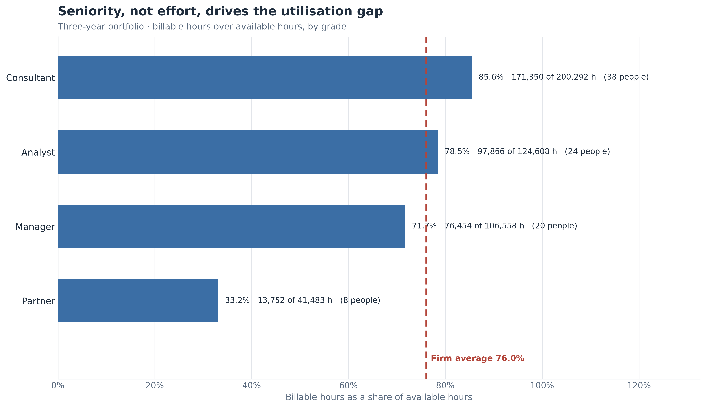
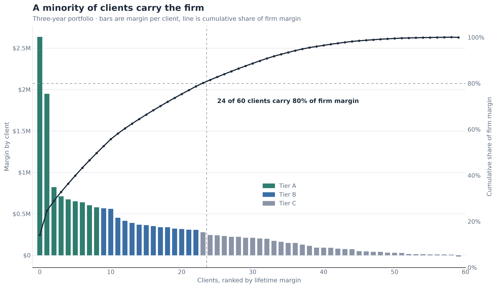
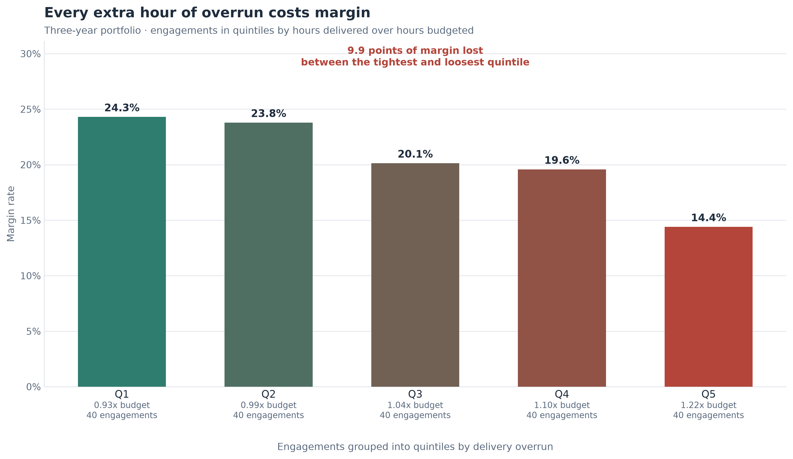
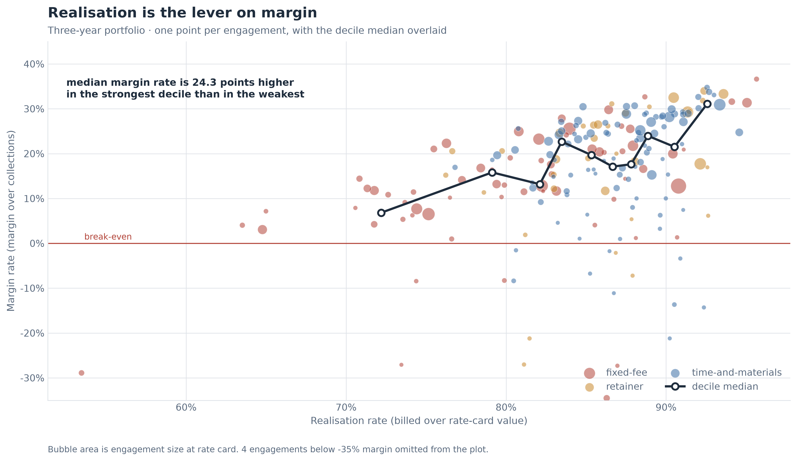

# Engagement Profitability Analytics

An end-to-end analysis of a consulting firm's engagement economics: a synthetic
portfolio generated from a fixed seed, a metrics layer that defines every
commercial ratio once, and two front ends that read from it — a self-contained
HTML report and an interactive Streamlit application. The question it exists to
answer is the one a managing partner asks when the year closes and the revenue
line looks fine.

**We billed $37.7M in FY2025 — why is margin only 19.1%, and what is recovering the gap worth?**

This is not a report about revenue. Revenue was on plan. It is a report about the
$8.9M that never became revenue, where it went, and which of it is recoverable.

---

| | |
| --- | --- |
| **Question** | Where does margin leak between the rate card and the bank, and what is closing the gap worth? |
| **Data** | Synthetic. 200 engagements, 60 clients, 90 consultants, 11,350 timesheet rows, three years |
| **Headline year** | FY2025 — 165 engagement-years, $44.7M of rate-card value |
| **Answer** | 19.9% of the rate card is lost before or after invoicing; 78% of it is discounts and unbilled time, both of which the firm controls |
| **Biggest lever** | Fixed-fee realisation, worth $2.63M a year at the standard the firm already achieves on time-and-materials |
| **Stack** | Python 3.14, pandas, NumPy, matplotlib, Streamlit, pytest |
| **Reproduce** | `python cli.py all` then open the HTML report |

---

## The finding

FY2025 delivered **$44,718,546** of work at the firm's own rate card. The firm
billed **$37,722,290** and collected **$35,803,360**, keeping **$6,843,034** — a
margin rate of **19.11%**. Realisation was **84.35%**; collection was **94.91%**.

That is a 19.9% loss against the rate card, and the waterfall says it is not one
problem:

| Step | Amount | Share of rate card |
| --- | ---: | ---: |
| Standard value | $44,718,546 | 100.0% |
| Discounts | −$4,319,578 | 9.7% |
| Unbilled time | −$2,676,678 | 6.0% |
| Write-offs | −$1,918,931 | 4.3% |
| Direct delivery cost | −$5,084,357 | 11.4% |
| Consultant cost | −$23,875,969 | 53.4% |
| **Actual margin** | **$6,843,034** | **15.3%** |

The three leakage steps sum to **$8,915,187**, which is exactly the gap between
the rate card and cash. The two cost lines below them are what it costs to
deliver, and they are not leakage; the expensive one is the business model
working.

---

## What the numbers say

### 1. The margin problem is a pricing and scope problem, not a collections problem

The firm loses **$8,915,187** before the invoice exists and **$1,918,931** after
it. Realisation, not collection, is where the money is — and the two need
opposite remedies. Chasing debtors harder is worth at most $1.9M and would
recover a fraction of it. The $7.0M of discounts and unbilled time is decided
inside the firm, by people who could decide differently next quarter.

Unbilled time deserves particular attention because nothing currently reports it.
Discounts are negotiated and visible; write-offs age on a report; unbilled hours
sit in the timesheet system while the invoice stays correct against the fee, and
the variance is absorbed silently by the engagement's margin.

### 2. Fixed-fee work is the single largest addressable gap

| Contract type | Engagements | Realisation | Margin rate | Overrun | Unbilled |
| --- | ---: | ---: | ---: | ---: | ---: |
| Time-and-materials | 99 | 87.4% | 23.5% | 0.99x | 3.2% |
| Retainer | 35 | 87.7% | 23.7% | 1.06x | 3.8% |
| Fixed-fee | 66 | **81.5%** | **16.4%** | **1.10x** | **8.7%** |

Fixed-fee work realises 5.9 points below time-and-materials and runs 11% over
budget against 1% under. It carries **8.7% of its rate-card value as unbilled
time against 3.2%** — nearly three times the rate. That is not a delivery
failure; it is what happens when the fee is fixed and the hours are not, so the
extra hours have nowhere to go. A 16.4% margin rate against 23.5% is the cost of
that missing mechanism, and it is priced at $2.63M a year.

### 3. Overrun, not price, is what erodes the margin on the work

Across the portfolio, overrun and margin rate are inversely related
(r = −0.293, slope −0.519). Sorted into quintiles:

| Overrun band | Mean overrun | Margin rate |
| --- | ---: | ---: |
| Cheapest | 0.93x | 24.3% |
| | 0.99x | 23.8% |
| | 1.04x | 20.1% |
| | 1.10x | 19.6% |
| Most overrun | 1.22x | **14.4%** |

An engagement that consumes 22% more hours than planned earns two-thirds of the
margin of one that comes in under. The same pattern shows in the realisation
deciles: median margin rate is **6.8% in the weakest decile and 31.1% in the
strongest**, a 24-point spread that no pricing table explains on its own.

### 4. The client book is concentrated, and the tail does not pay for itself

| Tier | Clients | Revenue share | Margin share | Margin rate |
| --- | ---: | ---: | ---: | ---: |
| A | 9 | 46.6% | 49.7% | 22.0% |
| B | 14 | 27.4% | 29.0% | 21.8% |
| C | 37 | 26.0% | 21.3% | 16.9% |

**Twenty-three of sixty clients carry 80% of the firm's margin.** The largest,
Uplands Resources, carries 14.1% of it on its own. Tier C is 62% of the client
book and produces a 16.9% margin rate against 22.0% at the top — a quarter of the
firm's revenue earning three-quarters of the margin rate.

### 5. Small engagements destroy margin, and they are not random

**23 engagements lost money in FY2025, destroying $483,556.** Nineteen of the 23
are small. The median loss-maker carries **$79,562** of rate-card value against
**$387,704** for an engagement that makes money — roughly a fifth the size. The
failure is not weak pricing: loss-makers realise at 82.1% against 84.9%, barely
different. It is that the fixed cost of mobilising a team does not scale down
with the engagement.

### 6. The firm is not short of capacity, and grade mix is not the problem

Utilisation is **76.0%** firm-wide, against a 76% target: Consultant 85.6%,
Analyst 78.5%, Manager 71.7%, Partner 33.2%. The pyramid behaves. No grade is
structurally idle and no grade is burning out, which rules out the two easiest
explanations for weak margin and points back at pricing and scope.

Service lines differ but none is broken: Strategy 26.1% margin, Operations 21.0%,
Digital 16.1%, Risk 20.0%. Digital carries the deepest discounts (10.2% of rate
card) and the highest delivery cost share, which is enough to explain the gap
without a story about execution.

### The figures

| | |
| --- | --- |
|  |  |
| *Rate card to margin: where each dollar goes, FY2025* | *Utilisation by grade against the 76% firm target* |
|  |  |
| *Client concentration — 23 of 60 clients carry 80% of margin* | *Margin rate against overrun, by quintile* |
|  | |
| *Realisation against margin rate, engagement by engagement* | |

---

## What closing the gap is worth

Raising realisation on the **bottom quartile of engagements by realisation** — 50
engagements carrying $26.9M of rate-card value, all at or below 82% — is worth:

| Realisation recovered | Incremental billing | Incremental margin |
| ---: | ---: | ---: |
| +2 points | $537,026 | $505,693 |
| +5 points | $1,342,565 | **$1,264,234** |
| +10 points | $2,685,129 | $2,528,467 |

These are deliberately conservative. Recovered billing is collected at the rate
those engagements already achieve (94.2%), not at 100%; no new work is assumed;
and no incremental delivery cost is charged, because the hours have already been
worked. That last assumption is what makes realisation a cheaper lever than
growth — and it is also the one that fails if "recovering realisation" turns out
to mean working more hours.

The full method, including the assumptions a reader should argue with, is in
[`docs/methodology.md`](docs/methodology.md).

---

## Three recommendations

**1. Convert the fixed-fee overrun into priced change control — $2,634,085.**
Fixed-fee work realises at 81.5% against 87.4% on time-and-materials, an 11%
overrun against 1% under, and carries 8.7% of its rate-card value as unbilled
time. A fixed fee should fix the scope, not the hours: require a signed change
order once delivered hours pass budget, and price mobilisation separately instead
of absorbing it. *Assumes fixed-fee work reaches the standard the firm already
achieves elsewhere — a 5.9-point improvement, not a new capability.*

**2. Run a commercial review on the bottom realisation quartile — $1,264,234.**
Fifty engagements carrying $26.9M of rate-card value realise at or below 82%.
Before the next invoice run: confirm scope against delivered hours, re-paper
out-of-scope work as change orders, and submit the unbilled time that is still
recoverable. This is $1.26M of billing the firm has already earned.

**3. Put a floor under small engagements — $483,556.**
Nineteen of the 23 loss-makers are small, and the median loss-maker is a fifth
the size of a profitable engagement. Set a minimum engagement size by service
line, or price a standing mobilisation fee covering the first phase. Where a
small engagement is genuinely strategic, book it as business development so it
stops distorting service-line margin.

**These three are not additive.** They act on overlapping populations — a small
fixed-fee engagement with weak realisation is counted by all three. Each figure
is individually defensible; the sum is not a plan.

---

## Deliverables

Run `python cli.py all` and the pipeline produces:

- **`reports/engagement_profitability_report_YYYYMMDD.html`** — a self-contained
  report with all five figures inlined as base64. No CDN, no network, no server.
  Open it from the filesystem and it works offline, which is what makes it
  sendable.
- **`reports/metrics.json`** — every headline metric, machine-readable.
- **`reports/tables/*.csv`** — 11 tables at engagement, client, grade and year
  grain.
- **`reports/figures/*.png`** — the five figures at 300 dpi.
- **`python cli.py app`** — an interactive Streamlit front end with filters for
  service line, contract type, client tier and start date. It recomputes nothing:
  every figure on screen comes from `src/analysis.py`, so the app and the report
  cannot disagree.

---

## Methodology

The full definitions are in [`docs/methodology.md`](docs/methodology.md). The
short version:

**Rate-card value** is delivered hours valued at the grade's standard rate — what
the work was worth before any commercial conversation. **Billed** is that less
discounts and less time that could never be invoiced. **Collected** is the
invoice less write-offs, and it is net revenue against which margin is always
measured. **Realisation** (billed / rate card) and **collection** (collected /
billed) are kept separate because they are different failures with different
owners: realisation is lost before the invoice exists and is entirely within the
firm's control, collection is lost after it and is not.

**Margin is defined as the waterfall residual**, not re-derived from collections.
The two are algebraically identical, but defining it this way means the published
waterfall adds up exactly instead of drifting by a cent per engagement —
`waterfall_reconciles()` asserts the identity, and the test suite asserts it again
on hand-computed inputs. On the published FY2025 data the residual is below
6 × 10⁻¹¹ of a dollar.

**Annual figures are percentage-of-completion allocations.** An engagement's money
is spread across calendar years in proportion to the hours worked in each, so
year rows sum back exactly to the engagement-level row. Utilisation is recomputed
from summed hours at every level of aggregation rather than averaged across
people, so a part-year joiner does not carry a full year of denominator.

---

## Project structure

```
engagement-profitability-analytics/
├── cli.py                      # command line entry point; four idempotent stages
├── requirements.txt            # pinned dependencies
├── README.md
├── app/
│   └── app.py                  # Streamlit front end; filters and formats only
├── data/
│   └── raw/                    # generated CSVs (gitignored)
│       └── .gitkeep
├── docs/
│   └── methodology.md          # every metric defined, every assumption stated
├── reports/                    # build output (gitignored)
│   ├── figures/                # five PNGs at 300 dpi
│   ├── tables/                 # 11 CSVs
│   └── .gitkeep
├── src/
│   ├── config.py               # single source of truth for paths and constants
│   ├── generate_data.py        # synthetic portfolio from a fixed seed of 42
│   ├── analysis.py             # every metric; the report and app both call this
│   ├── plots.py                # the five figures
│   └── report.py               # HTML report, metrics.json, CSV tables
└── tests/
    ├── conftest.py             # hand-built fixtures with answers known by hand
    ├── test_analysis.py        # waterfall identity, tiers, sensitivity, allocation
    ├── test_config.py          # settings singleton, paths, rate-card coherence
    ├── test_generate_data.py   # reproducibility, referential integrity, money
    └── test_report.py          # self-contained, well-formed, numbers tie out
```

---

## Getting started

```bash
python3 -m venv venv
./venv/bin/pip install -r requirements.txt

./venv/bin/python cli.py generate-data   # write the synthetic CSVs
./venv/bin/python cli.py analyze         # metrics, tables and figures
./venv/bin/python cli.py report          # the self-contained HTML report
./venv/bin/python cli.py app             # the Streamlit application
./venv/bin/python cli.py all             # generate, analyze and report
./venv/bin/python cli.py info            # resolved paths, constants, pipeline state
```

Every stage is independently re-runnable: changing the analysis does not require
regenerating the data, and regenerating the data does not invalidate the report
until it is rebuilt.

### Tests

```bash
./venv/bin/python -m pytest -v
```

**123 tests, all passing.** The fixtures in `tests/conftest.py` are small tables
built by hand — a two-engagement fact table, a three-person roster, four
engagements spanning the realisation range — and every expected value is worked
out on paper from those numbers rather than taken from a run of the code under
test. The suite would still fail if a formula quietly changed in a way that
happened to stay self-consistent.

The generator's own output is asserted too: that the seed reproduces it exactly,
that every foreign key resolves, that every engagement is staffed by every grade,
that timesheet hours reconcile to the plan, that nobody is booked beyond their
availability, and that the waterfall identity holds on every row.

---

## Limitations

**The data is synthetic.** Every number here describes a generated portfolio, not
a real firm. The structure is modelled on how consulting firms behave — fixed-fee
work overruns, small engagements struggle to cover mobilisation, some service
lines carry structurally lower realisation — but the magnitudes are assumptions,
not observations. The generator's module docstring lists every one of them.

**Assignment by grade is an allocation, not a measurement.** Billing is recorded
against an engagement, so the by-grade view spreads each engagement's billing
across grades in proportion to the rate-card value each contributed. It shows
which grades staff the engagements where realisation is won or lost. It does not
show that any grade prices differently.

**Money moves across years by hours.** Percentage-of-completion is a reasonable
approximation for a portfolio of this shape, but it is an approximation. A
portfolio with large milestone payments would break the assumption.

**The sensitivity is static.** It holds collection rates and cost shares fixed
while realisation moves. In practice those interact — pushing realisation harder
can slow collection, which is the trade the estimate does not price. Every
recovery figure is an opportunity, not a forecast.

**Unbilled value is a residual, not a ledger entry.** The generator derives it
from the gap between delivered value and the engagement's fee. A real firm would
read it from a system that flags write-downs, which would make it measurable
rather than inferred.

**One year is not a trend.** Three years of synthetic history are reported, enough
to show the direction of margin rate and not enough to establish one.

---

## Licence

Released for portfolio and educational use. The data is synthetic and contains no real information.
